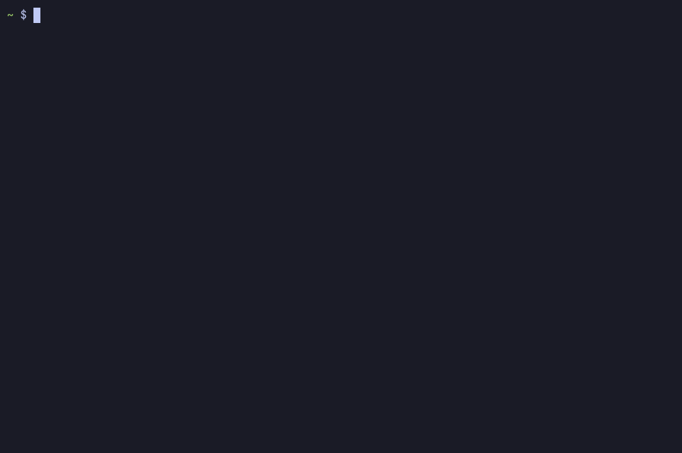

# tabden

[](https://github.com/rwmtabag/tabden/actions/workflows/shellcheck.yml)

A wizard that turns an Android tablet into a terminal-first dev environment: Termux, an Ubuntu userland, Claude Code, Helix and tmux.



## Quick start

In [Termux](https://termux.dev) (from F-Droid or GitHub; the Play Store build is a different one):

```bash
pkg install -y git && git clone https://github.com/rwmtabag/tabden ~/tabden && bash ~/tabden/launcher.sh
```

Pick **Lean** and choose a username. When it finishes, restart Termux and run `den`. Do the one-time steps (`claude`, `gh auth login` and `git-id default`) inside the session; `den help` lists everything else.

## Lean or custom

| | Lean (default) | Custom adds |
| --- | --- | --- |
| AI | Claude Code | Ollama or llama.cpp with a 1–4B model |
| Editor | Helix | Roslyn C# language server, VS Code in the browser |
| Runtimes | .NET 10, Rust, Bun | Node.js |
| Tools | tmux, git, lazygit, delta, gh, fzf, ripgrep, zoxide, bat | eza, Starship, btop |
| Look | Termux's own colours | A theme: Catppuccin Mocha, Tokyo Night or Gruvbox dark |
| Other | | Docker CLI driving a remote arm64 host |

Lean asks only for a username. Run `tabden modify` later to change anything, or `tabden theme NAME` to switch [theme](docs/customization.md#themes) in a few seconds.

<!-- Screenshots, one per theme (tmux bar, Helix and a delta diff in view):
     docs/img/theme-catppuccin-mocha.png, docs/img/theme-tokyonight.png, docs/img/theme-gruvbox-dark.png -->

## Tested on

| Device | OS | Termux | Status |
| --- | --- | --- | --- |
| Huawei MatePad 11.5S (8 GB) | HarmonyOS 4.2.0 | F-Droid | Tested: fresh Lean install, uninstall with the `local.sh` backup, theme switching, demo recording (Oct 2026) |

Reports from other devices are welcome.

## Docs

- [Guide](docs/guide.md): how it's built, installing, daily use, components
- [Customization](docs/customization.md): CLI extras, themes, the Starship profile, your own settings
- [Troubleshooting](docs/troubleshooting.md)
- [Design notes](docs/design.md): how the installer works, for changing the scripts

## License

[MIT](LICENSE).
