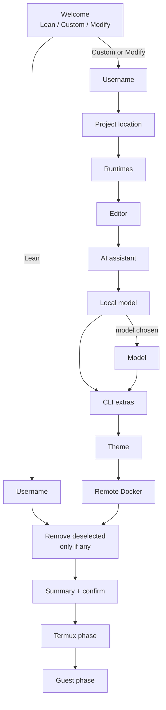

# Design notes

How the installer works, for anyone changing the scripts. User-facing behaviour is in the [guide](guide.md).

## Two scripts, one selections file



Every screen has Back; Back from the first screen returns to Welcome. Modify re-opens the wizard with the current selections.

1. **`launcher.sh` (Termux)** runs the wizard with `dialog`, then writes `~/.config/tabden/selections.env`.
2. **Termux phase:** Termux packages, the extra-keys row, the Ubuntu guest via proot-distro, the user and its sudoers file, the local model runtime if chosen, the projects folder (moving any existing Ubuntu-home projects across), and the Termux-side commands.
3. The launcher copies `guest.sh` to `~/.local/share/tabden/` in the guest and the selections file to `~/.config/tabden/`.
4. **Guest phase:** `guest.sh --install` runs as the user, with projects mounted, non-interactively, reading only the selections file. It first removes anything listed in `REMOVE`, then installs. It records results in `~/.cache/tabden/result` and `notes`, which the launcher reads for the final screen.

```bash
# selections.env (lean defaults)
PROFILE="lean"
DEV_USER="<user>"
PROJECTS_MODE="termux"    # termux (mounted) | guest
TIMEZONE="Europe/Lisbon"  # read from Android; empty = UTC
TABDEN_DIR="/data/data/com.termux/files/home/tabden"   # the clone, for `tabden`
REMOVE=""                 # set by the removal screen for this run only
RUNTIMES="dotnet rust bun"
IDE="helix"               # helix | helix-roslyn | vscode | both
IDE_HELIX="1"
IDE_ROSLYN="0"
IDE_VSCODE="0"
AI_CLAUDE="1"
AI_LOCAL="none"           # none | ollama | llamacpp
LOCAL_MODEL=""
LLAMA_HF=""               # Hugging Face spec for llama-server -hf
CLI_EXTRAS="lazygit delta gh"
DOCKER_REMOTE="0"
DOCKER_SSH_HOST=""
THEME="default"           # default | catppuccin-mocha | tokyonight | gruvbox-dark
```

How .NET was installed is detected (`~/.dotnet/dotnet` exists) rather than stored.

## Install record

Each component that tabden actually installs is recorded as `<id> <origin> [detail]`, in `~/.config/tabden/installed` inside Ubuntu, and in the same path in Termux for Ollama and llama.cpp. `origin` is `tabden`, or `adopted` for installs found the first time a version with tracking runs: anything present at tabden's install locations is recorded then, and offered for removal unticked. Something already present when tabden would have installed it is never recorded, so it's never removed.

The wizard's removal screen offers recorded components that the new selections don't include. The guest removes an id only if it's recorded and not selected; each `remove_x` undoes what `install_x` did plus its config, and `apt autoremove` runs once after any apt removal. User data stays: `~/.claude`, `~/.config/gh`, Helix's own config, projects.

| Component | Removal |
| --- | --- |
| .NET 10 | `apt remove dotnet-sdk-10.0`, or delete `~/.dotnet` for script installs |
| Rust | `rustup self uninstall` |
| Bun | delete `~/.bun` |
| Node.js, gh, git-delta, eza, btop | `apt remove`; delta also unsets the git settings tabden made |
| Claude Code | delete `~/.local/bin/claude` and `~/.local/share/claude` |
| Helix, lazygit, VS Code CLI | delete the binary in `/usr/local/bin`; Helix's runtime folder; VS Code's server data and token |
| Roslyn LS | `dotnet tool uninstall` and the Helix LSP block |
| Starship | delete the binary, and `starship.toml` if tabden wrote it |
| Docker | delete the `remote` context, `apt remove` the CLI and plugin, delete Docker's apt source |
| Ollama, llama.cpp (Termux) | `apt remove`, plus `~/.ollama` or `~/.cache/llama.cpp` |

## Themes

`THEME=default` means tabden sets no colours: the Termux step isn't run and `guest.sh` generates the same files as it did before themes existed. Any other value is applied in two places.

- **Termux (`t_theme`).** Writes `~/.termux/colors.properties` from the palette table in `launcher.sh`, with `# written by tabden: theme <name>` as its first line, and runs `termux-reload-settings`. The mark is the ownership test: a file without it is never replaced or deleted, and a note goes to the last screen instead. `theme tabden <name>` is also written to the Termux install record; `recorded_components` skips that line, because the removal screen treats every recorded id as a component with a `remove_x`.
- **Ubuntu (`write_dotfiles`).** The tmux block uses palette indexes (`colour0`, `colour7` and one accent per theme) rather than hex values, so the bar follows whatever palette the terminal has. `env.sh` gets `BAT_THEME=ansi`, and `COLORTERM=truecolor` only when it's empty. `theme_delta` sets `delta.syntax-theme ansi` when it's unset and removes it only while it's still `ansi`. `theme_helix` writes Helix's theme.
- **Helix needs `prepend_block`.** `theme = "..."` is a top-level TOML key and must come before the first `[table]`; `write_block` appends, which would put it inside whichever table the user's `config.toml` ends with. `prepend_block` writes the managed block at the top of the file instead. If the user's own part of the file has a `theme =` line, the block is removed rather than written, since two `theme` keys make the file invalid, and the file is deleted when removing the block leaves it empty.
- **tmux truecolor uses a fixed slot.** `set -s terminal-features[99] 'xterm-256color:RGB'` rather than `set -as`, which adds another entry every time the config is read again.
- **`tabden theme NAME`** skips preflight and the wizard: it saves the selection, runs `t_theme`, copies the current `guest.sh` and selections into Ubuntu (the installed copy may predate `--dotfiles`), and runs `guest.sh --dotfiles`. That mode runs `write_dotfiles` only, then, if a tmux server is running, unsets the two options only a theme sets (`pane-active-border-style`, `window-status-current-style`) and re-reads `~/.tmux.conf`, because a running server keeps options the new config no longer mentions.
- **Checking a palette.** The values were compared with `catppuccin/termux` (`themes/catppuccin-mocha.properties`), `folke/tokyonight.nvim` (`extras/termux/tokyonight_night.properties`) and the dark palette in `morhetz/gruvbox` (`colors/gruvbox.vim`). Upstream has no `cursor` key for the first two; tabden uses Catppuccin's rosewater and the foreground colour.

## Commands

| Side | Files | Notes |
| --- | --- | --- |
| Termux | `~/bin/den`, `ubu`, `tabden`; shared helpers in `~/.local/share/tabden/termux-common.sh` | `den` takes the wake lock and opens the session in Ubuntu; `den stop` ends it from Termux; `den status` runs Ubuntu's report with projects mounted; `den help` shows the cheat sheet; `den update` points to `tabden update`. After `den` or `ubu` returns, the session is checked: gone → stop the local model and release the wake lock; detached → keep both |
| Ubuntu | `~/bin/den` | `den` opens or attaches the tmux session `den` and refuses to nest inside tmux; `den stop` ends it and leaves cleanup to the Termux side; `den status`, `den update` (runs `guest.sh --update`), `den help` |
| Ubuntu | `~/bin/git-id`, `git-credential-gh-account`; the `ws` function in the `.bashrc` block | See [Git identities](#git-identities) |

## Git identities

`git-id` keeps one file per identity in `~/.config/tabden/git-identities/<name>.gitconfig` and links it from `~/.gitconfig` with `includeIf "gitdir:<folder>/"`. The file holds `user.name`, `user.email` and a `[tabden]` section (`dir`, `ghuser`, `sshkey`) that `git-id` reads back; the default identity is the global `user.*` plus `tabden.ghuser`. The files are the user's data: tabden installs the commands, and only `git-id` creates, changes or deletes identities. Updates and component removal leave them alone, and they aren't part of the uninstall backup.

- **Per-folder account for git.** An identity with a GitHub login sets `credential.https://github.com.helper` to an empty value (which clears helpers set earlier) followed by `git-credential-gh-account <login>`. The helper returns `gh auth token --user <login>`, so git doesn't depend on gh's active account. When the login has no token it prints how to log in and returns `quit=1`, so git stops instead of asking for a password.
- **Default account pinned too.** Once any account is named, the global config gets the same helper for the default login. Without it, a push from a default-identity repo would use whichever account `ws` last made active in another window. `gh auth login` puts gh's own helper back, so `git-id` re-checks the pin on every change and on every `ws`.
- **Order in `~/.gitconfig`.** Git applies the last value it reads, so the includes must come after `[user]`, `[core]` and `[credential]`. `git-id` re-appends them after each change, deepest folder last so a nested identity wins, and `git-id` and `ws` repair the order if another tool has appended one of those sections since.
- **`ws` is a shell function** in the managed `.bashrc` block, because a script can't change the calling shell's folder. It calls `git-id path` and `git-id switch`; `switch` runs `gh auth switch` for the identity's login, or the default's when the identity has none.
- **Input that reaches a shell.** The login is embedded in the helper command line, so it must match GitHub's username pattern; the SSH key path can't contain spaces or quotes; folders can't contain glob characters, since `gitdir:` is a glob.

## Rules the scripts follow

- **Idempotent installs.** Each `install_x` skips anything already present, so re-runs are safe. GitHub-release binaries (Helix, lazygit, VS Code CLI, Starship) are re-fetched only on update.
- **Commands tabden owns.** Every script tabden writes to `~/bin` (on either side) has `# tabden-managed` as its second line. A file there without that line isn't tabden's: it's never overwritten, tabden's command of that name isn't installed, and the final screen says so. A command of the same name elsewhere on PATH doesn't stop tabden's: it's installed, the final screen names the command it now hides, and `tabden doctor` lists them. Uninstalling removes only files with the marker.
- **Managed blocks.** `.bashrc`, `.profile` and `.tmux.conf` content lives between `# >>> tabden >>>` and `# <<< tabden <<<` and is rewritten, never appended. Helix's `config.toml` uses the same markers at the top of the file (see [Themes](#themes)).
- **User hook.** The last line of each managed `.bashrc` block sources `~/.config/tabden/local.sh` if it exists (written as an `if`, so a missing file doesn't leave a failed exit status at the first prompt), and the last line of the tmux block is `source-file -q ~/.config/tabden/local.tmux.conf`. They sit inside the blocks because a line placed after a block wouldn't stay after it once the block is rewritten. tabden writes only `local.sh.example`; uninstall backs the user's files up from both sides to `~/tabden-local-backup/` and keeps the folder in place if the copy fails.
- **One environment file.** `~/.config/tabden/env.sh` holds PATH, the .NET heap limit, TZ, EDITOR and a UTF-8 locale (`LANG=C.UTF-8` when none is set: proot-distro passes no locale in, and tmux then draws every non-ASCII character as `_`). Both `.profile` (login shells, including `ubu <command>`, which runs through `bash -lc`) and `.bashrc` (tmux windows) source it, so non-interactive commands get the same environment.
- **Keep going on failure.** Each step is logged; failures are listed on the final screen, and `tabden modify` retries them. Steps run in a pipeline (a subshell), so anything a step has to report afterwards goes to a file: `apt-removed` and `notes` in Ubuntu, `termux-notes` in Termux.
- **Deselecting removes config; uninstalling is explicit.** Aliases, prompt and the Helix LSP block follow the selections. Packages are removed only when ticked on the removal screen, and only if tabden recorded installing them.
- **Updates rewrite generated files.** `guest.sh --update` also rewrites scripts, dotfile blocks and the cheat sheet, so script changes reach existing installs.
- **Lint before pushing.** `bash -n` on each of `launcher.sh`, `guest.sh` and `tools/record-demo.sh`, then `shellcheck -S warning launcher.sh guest.sh tools/record-demo.sh`, must both pass. CI (`.github/workflows/shellcheck.yml`) runs exactly those commands on every push to `main` and on every pull request, with the shellcheck that ships on GitHub's `ubuntu-latest` runner, so run them locally first.
- **The scripts are the source of truth.** Where docs and scripts disagree, the scripts win; fix the docs in the same commit.

## Commands and options

`tabden` in Termux runs `launcher.sh` from the clone with the same arguments; `tabden update` first runs `git pull --ff-only` in the clone, and `launcher.sh update` itself never pulls. Before the first install, the same commands are run as `bash launcher.sh ...`.

| Command | Effect |
| --- | --- |
| (none) | The wizard: Lean, Custom, or Modify when an install exists |
| `install [lean\|custom]` | Install; without `lean` or `custom` it asks which. `lean` asks only for the username |
| `modify` | The wizard with the current choices preselected; also retries failures |
| `update` | Update Termux packages, the commands and Ubuntu |
| `theme NAME` | Switch theme on an existing install: Termux palette and Ubuntu dotfiles only. No preflight, no packages |
| `uninstall` | Remove tabden; asks what to keep, and for DELETE before removing the guest or projects |
| `doctor` | One read-only report; see [Doctor](#doctor) |
| `fix-phantom` | Print how to turn off Android 12+'s phantom process killer for this Android version; changes nothing |
| `help`, `version` | The header comment, the version |

| Option | With | Effect |
| --- | --- | --- |
| `--dry-run` | install, modify, the wizard | Confirming the Summary prints what would be installed and removed, then stops. See [Dry run](#dry-run) |
| `--yes` | install | Skip the summary; needs `--user` or a `--config` file with `DEV_USER`. Never removes anything. Without `lean` or `custom`, means `lean` |
| `--user NAME` | install | Preset the username |
| `--config FILE` | install | Take every choice from a selections file |
| `--skip-preflight` | install, modify, update, the wizard | Skip the space, RAM, Termux-build and network checks |

An option given with a command it doesn't go with is refused with a message, and so are the old flag forms (`--modify` and so on), which name the command to use instead.

### Dry run

`--dry-run` works with `install`, `modify` and the wizard, and is refused with every other command. Every screen behaves as usual. When the Summary is confirmed, `main` calls `dry_run_report` and returns before `save_selections` and `install_all`, so `selections.env`, both install records, the Termux commands and the Ubuntu guest are untouched. The report repeats the Summary's choices, lists the selected components (installs skip anything already present) and the ones ticked for removal, and says nothing was changed.

Two things still happen before the wizard, as in any run: preflight rewrites `~/.cache/tabden/termux.log`, and `bootstrap` installs `dialog`, `proot-distro` and `curl` if one is missing, since the wizard can't be shown without them. The timezone on the Summary is read as usual (`TZ` first, then Android), and isn't saved.

`guest.sh` (inside Ubuntu): `--install`, `--update` (what `den update` runs), `--update-binaries`, and `--dotfiles` (rewrite dotfiles, scripts and the cheat sheet only; what `tabden theme` runs).

## Doctor

`tabden doctor` reads and reports; it writes no log and installs nothing, and it doesn't stop on a failed check the way preflight does. It's meant to be pasted into a bug report, so it never prints the username, git names or emails, the VS Code token or the timezone's name, only whether each is set. Paths of hidden commands show the home folder as `~` on both sides, since Ubuntu's home path contains the username.

- **Device:** Android SDK and architecture, Termux build, RAM, free space, whether github.com answers, and the phantom process killer's state (pointing to `tabden fix-phantom`).
- **Install:** the selections (profile, theme, where projects live), the clone (branch, last commit, local changes), whether a timezone is set, whether the Ubuntu guest starts and the user exists, and the Termux commands: present, tabden's own (the marker), and any command each one hides.
- **Ubuntu,** from one login with projects mounted as `den` would: the release, whether the projects mount works, the den session, the last install's result and failed steps, the UTF-8 locale, whether a git identity is set, the Ubuntu commands as above, and tool versions.

Problems are counted at the end. The issue template asks for this report first.

## Preflight

`preflight` runs after `ensure_termux` and before the wizard's prerequisites are installed, for every command except `uninstall`, `fix-phantom`, `theme` and `doctor`. It starts `termux.log` and writes each result there.

- **Stops:** under 4 GB free when no Ubuntu guest exists yet; `curl -fsI --max-time 5 https://github.com` failing twice.
- **Warnings** (collected in `PRE_WARN`, shown with the other summary warnings, printed directly for `update`): under 1 GB free on an existing install; `MemTotal` under 5000 MB, which means devices sold as 4 GB (`MemTotal` is below the advertised size: a "6 GB" device reports roughly 5.3–5.6 GB, so the earlier 6144 MB threshold warned every one of them); `TERMUX_APK_RELEASE` (or the newer `TERMUX_APP__APK_RELEASE`) equal to `GOOGLE_PLAY_STORE`, or neither set.
- **In the summary:** on a new install, a warning when free space is below the estimate plus 1 GB. The local-model warning quotes the device's real RAM.
- The space stop applies only to new installs, so a full device can still update, remove components or uninstall. `--skip-preflight` skips everything.

## Phantom process killer check

`check_phantom` reads `ro.build.version.sdk` and reports `disabled`, `enabled`, `unknown` or `na` (Android 11 and older). On Android 12 (SDK 31) the on/off flag doesn't exist, so it looks at `device_config get activity_manager max_phantom_processes`. On 12L and later it reads `settings get global settings_enable_monitor_phantom_procs` (what `adb` sets), then the system property `persist.sys.fflag.override.settings_enable_monitor_phantom_procs` (what the Android 14 developer option sets; turning Developer options off again writes `true`). An explicit `false` in either is `disabled` and an explicit `true` is `enabled`, the setting first, as Android itself reads them.

When the setting reads `null` and the property is empty, the result is `enabled`: neither was ever set, so the flag is at its default, which is on. That relies on an empty property meaning "unset" rather than "not readable", which holds in AOSP's SELinux policy: `persist.sys.*` is labelled `system_prop`, a `core_property_type`, and app domains (Termux runs as `untrusted_app_27`) may read those. Checked in `system/sepolicy` for Android 12L to 16; a vendor policy that restricts it would produce a wrong "on" here, which can't be ruled out from the source. Anything that isn't a clean read is `unknown`: the `settings` or `device_config` command failing when run from an app (the Android 12 test tablet reports `unknown`), `getprop` failing or timing out, or an unexpected value. Every call has a 3-second limit, and the result only produces a warning. The `den status` script in Ubuntu carries the same logic, calling the tools in `/system/bin`.

## Summary-screen warnings

- A local model plus VS Code or Roslyn: both compete for the same RAM (the device's real figure is shown).
- Preflight warnings: low RAM, Termux build, low free space.
- Roslyn LS without .NET selected.
- No AI assistant selected.
- The phantom process killer is on, or its state can't be read (Android 12+).

## Refreshing the demo and screenshots

**The demo GIF** in the README is `docs/img/demo.gif`. It's built by CI from a recording, so it's never edited by hand.

1. In Termux on a device with tabden installed: `pkg install asciinema tmux` once, then `bash tools/record-demo.sh` from the clone. `--check` first shows what the recording would contain without recording.
2. Read its output. It says which theme will be visible, and warns before recording if the wizard would show a "Remove deselected components" screen (with `--wizard modify` as the alternative). After recording it must say that nothing changed and that the privacy check found nothing; otherwise it writes nothing.
3. Commit `docs/demo/` (`demo.cast` and `demo.theme`) and push. The `demo-gif` workflow renders the GIF and commits it to the same branch; the job summary shows its size and dimensions.

How the recorder stays safe and repeatable:

- **Nothing is installed.** The wizard is always run with `--dry-run`. Each step reads the dialog's title from the screen and only sends a key to a screen it knows; the Summary is confirmed only while a launcher process with `--dry-run` on its command line is running. An unexpected screen makes it leave the wizard and stop.
- **Nothing is changed.** It refuses to start while a `den` session is running or if `~/projects/tabden-demo` exists, checksums `selections.env` and the install records on both sides before and after, removes the sample project, and stops only the session it started. It does add a few lines to Ubuntu's shell history, and the wizard rewrites `termux.log`.
- **Same size and timing each time.** It records a detached 100x28 tmux session on its own server (`tmux -L tabden-demo`, with its own three-line config and none of yours, status bar off), with asciinema as the only client. Commands are typed at a fixed speed, and only once the shell shows a prompt. Typing keeps its pace by the clock (35 ms per character on average, sending a few characters at once if calls fall behind), and short waits use the shell's own `read -t` rather than `sleep`: on Android every process start costs tens of milliseconds, which one `sleep` per character turned into seconds of recording. The cost of a tmux call is measured first and allowed for in pauses. Each screen is held for a set time counted from when it appeared. Two edits are made to the recording's timing before it's saved: the wait while a program starts or a prompt comes back is cut to 0.4 s, and the recorder's own exit is cut off the end. CI then caps any pause at 2 s, so the Summary's 3 s shows as 2 s.
- **`den` runs unmodified inside the recorder's tmux.** The shell there has no `TMUX` variable, and current proot-distro builds Ubuntu's environment from scratch anyway, so `den`'s "already in tmux" check isn't touched.
- **The username shown is `demo`, never yours.** With `--wizard custom` it's typed into the empty Username box. With `--wizard modify` the box opens with your name in it, so the recorder first covers the window with a still copy of itself, starts the wizard behind the cover, erases your name, and uncovers it to type `demo`; the screens read while covered aren't kept. `demo` is a new user, so the dry run asks for a password: a throwaway one (`demo-only`, shown as asterisks) is typed only while a `--dry-run` launcher is running. The Ubuntu prompt has no username in it (`ubuntu ~/projects $`).
- **The Theme screen shows the theme in use.** With a theme set, the recorder selects it on the Theme screen (arrow keys, then Space, checked on screen), so that screen and the Summary's Theme line match the recording's colours. With no theme, the screen is left at its default. The dry run saves nothing either way.
- **The timezone shown is `Etc/UTC`.** The recorder's shell has `TZ=Etc/UTC`, which `android_tz` reads first; a dry run saves nothing, so the real timezone stays in `selections.env`.
- **Privacy check.** Token patterns (`?tkn=`, `ghp_`, `gho_`, `ghu_`, `ghs_`, `ghr_`, `github_pat_`, `sk-ant-`) and personal strings read at run time (your Ubuntu username as a whole word, not case-sensitive; git emails from Termux, Ubuntu and every git identity, the real timezone, the VS Code token, the Docker host, `--deny` words) are searched for in three places: the cast file, asciinema's plain-text export of it, and the screens the recorder read while stepping. A full-screen program can split a word across drawing commands in the first; the other two see it whole. Any match fails the run and nothing is written to `docs/demo/`. A username that is also a common word in the demo (`ubuntu`, `demo`, `den`, `dev`, `root` and a few more) or shorter than 3 characters can't be checked, since it would match the demo's own text; the recorder says so and goes on without that check. The demo never runs `den help`, `claude` or `gh auth`.

The workflow pins agg by version and by the sha256 of its release binary (agg publishes no checksum file), and takes a theme's colours from `theme_palette` in `launcher.sh`, so there is one source for them.

**Theme screenshots** are taken by hand, one per theme, and saved under the names the README placeholder lists:

1. `tabden theme NAME`, then `den stop` and `den` for a clean session.
2. Open the same layout each time: Helix on a source file, plus a `git diff` through delta, with the tmux bar visible.
3. Take a device screenshot, crop the Android status bar, and save it as `docs/img/theme-<name>.png` (`theme-catppuccin-mocha.png`, `theme-tokyonight.png`, `theme-gruvbox-dark.png`).

## Installing without a clone

`launcher.sh` can run without a clone, fetching `guest.sh` from `BASE_URL` (the repo's raw `main` by default; override with `TABDEN_BASE_URL`):

```bash
bash <(curl -fsSL https://raw.githubusercontent.com/rwmtabag/tabden/main/launcher.sh)
```

That path records no clone, so `tabden update` can't find one afterwards. The clone-based install in the README is the supported route.
