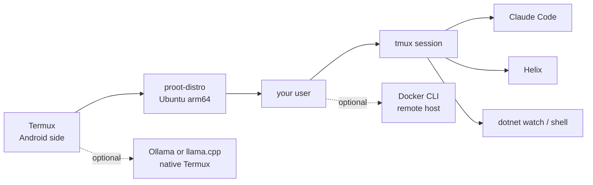

# Guide

tabden builds a terminal-first dev environment on an Android tablet: Termux, an Ubuntu userland in proot, and a tmux session with Claude Code and Helix. The lean default has no local LLM and no browser IDE; everything heavier is an opt-in choice in the wizard.

- [How it's built](#how-its-built)
- [Before you install](#before-you-install)
- [Installing](#installing)
- [Daily use](#daily-use)
- [Components](#components)
- [Updating and changing choices](#updating-and-changing-choices)

## How it's built



Local model runtimes run natively in Termux, not in proot, and are reached on `127.0.0.1`.

| Decision | Choice | Why |
| --- | --- | --- |
| Distro | Ubuntu (proot-distro's default) | apt-managed .NET on arm64; the most-used route for Claude Code on Android |
| Not native Termux | — | Claude Code's native binary has no android-arm64 build; Termux's bionic libc needs patched-binary workarounds |
| Not Arch Linux ARM or Alpine | — | Rolling updates break more often under proot; Alpine's musl adds friction |
| AI | Claude Code | Heavy reasoning off-device; local 1–4B models are an offline fallback only |
| Editor | Helix | No browser or VS Code server competing for RAM with Claude Code and builds |
| Local LLM | Off by default | Tablets are CPU-only with RAM shared with Android; 7B+ models get killed |
| Containers | Remote only | proot has no namespaces or cgroups, so Docker can't run on the tablet |
| Projects | Termux `~/projects`, mounted into Ubuntu | Survives resetting Ubuntu; keeps Linux permissions, unlike `/sdcard` |

## Before you install

**Requirements.** An arm64 (aarch64) Android device, and Termux from [F-Droid](https://f-droid.org/packages/com.termux/) or [GitHub](https://github.com/termux/termux-app/releases). The Play Store build is a separate one; use F-Droid or GitHub. The lean install takes roughly 3–4 GB; the wizard's summary screen shows an estimate and your free space.

**Checks before installing.** The installer checks a few things first and writes the results to `~/.cache/tabden/termux.log`:

| Check | Result |
| --- | --- |
| Under 4 GB free on a new install | Stops |
| GitHub unreachable (two tries) | Stops |
| Free space under the estimate plus 1 GB (new install) | Warning on the summary screen |
| Under 1 GB free on an existing install | Warning |
| Under 5 GB of RAM as Android reports it: devices sold as 4 GB. A 6 GB device reports about 5.5 GB and isn't warned | Warning |
| Play Store build of Termux, or the build can't be identified | Warning |

Add `--skip-preflight` to skip all of them, for example to install a small custom selection on a nearly full device. Uninstalling never runs these checks.

**Keep Termux alive.** Android's battery management kills background apps, and a killed Termux takes Ubuntu, tmux and Claude Code with it. Find your phone maker on [dontkillmyapp.com](https://dontkillmyapp.com) and follow its steps for Termux. On Huawei's HarmonyOS, for example: Settings → Battery → App launch → Termux, switch to manual and allow auto-launch, secondary launch and running in the background.

Huawei users: don't upgrade to HarmonyOS NEXT (HarmonyOS 5). It drops Android app support, and Termux with it.

`den` takes a Termux wake lock so the device doesn't sleep mid-task; `den stop` releases it (see [Daily use](#daily-use)).

**Android 12 and later: the phantom process killer.** Separately from battery management, Android 12+ keeps about 32 child processes across all apps and kills the rest with signal 9. tmux, Claude Code, builds and language servers all count. The installer checks the setting where Android lets it (often it can't tell), mentions it on the summary screen, and `den status` shows it. If sessions die while idle, run:

```bash
tabden fix-phantom
```

It prints the steps for your Android version: a Developer options toggle on Android 14+, or two or three `adb` commands on Android 12 and 13, which you can run from Termux itself over wireless debugging.

## Installing

```bash
pkg install -y git && git clone https://github.com/rwmtabag/tabden ~/tabden && bash ~/tabden/launcher.sh
```

Install from a clone like this rather than a `curl` one-liner: the installer records where the clone is, which is how `tabden update` finds it later.

The wizard runs in Termux. **Lean** asks only for a username, then shows a summary. **Custom** walks through each choice:

| Screen | Options (default in bold) |
| --- | --- |
| Username | No default. Validated; system accounts are rejected. A new user also sets a password |
| Project location | **Termux home, mounted into Ubuntu**, or Ubuntu home only |
| Runtimes | **.NET 10**, **Rust**, **Bun**, Node.js |
| Editor | **Helix**, Helix + Roslyn C# language server, VS Code Server, Helix and VS Code Server |
| AI assistant | **Claude Code**; local model: **None**, Ollama, llama.cpp |
| Model (only with a local model) | **Qwen2.5-Coder 1.5B** (autocomplete), Gemma 4 E2B, Phi-4-mini, Qwen 3.5 4B |
| CLI extras | **lazygit**, **git-delta**, **gh**, eza, starship, btop |
| Theme | **No theme**, Catppuccin Mocha, Tokyo Night, Gruvbox dark (see [Themes](customization.md#themes)) |
| Remote Docker | **No**, or the `user@host` of an arm64 Docker host |
| Summary | Choices, timezone, estimated disk use, warnings; Install or Back |

The installer then sets up Termux, creates the Ubuntu guest and your user (with passwordless `sudo` via `/etc/sudoers.d`), and installs everything inside Ubuntu. It keeps going if one component fails and lists failures on the last screen; run `tabden modify` to retry them.

After it finishes, restart Termux and run `den`. Three one-time steps are left, all inside Ubuntu:

```bash
gh auth login    # GitHub.com → HTTPS → "Login with a web browser"; open the URL it prints yourself
claude           # open the printed URL in your browser, approve, then /exit
git-id default   # the name and email for your commits
```

The `gh` login inside Ubuntu is separate from any `gh` login in Termux. When it asks "Authenticate Git with your GitHub credentials?", answer yes.

## Daily use

`den`, `den stop`, `den status` and `den help` behave the same in Termux and Ubuntu. `den update` updates only the Ubuntu side; in Termux, `tabden update` updates everything.

| Command | Where | Does |
| --- | --- | --- |
| `den` | Termux or Ubuntu | Start or return to the tmux session (takes the wake lock) |
| Ctrl-a d | tmux | Detach; the session keeps running and the device stays awake |
| `den stop` | Termux or Ubuntu | End the session, stop any local model, release the wake lock |
| `ubu` | Termux | Plain Ubuntu shell with projects mounted; `ubu <command>` runs one command |
| `den help` | Termux or Ubuntu | Cheat sheet for what you installed (Ctrl-a / in tmux) |
| `git-id` | Ubuntu | List, add or change git identities (see [Git identities](#git-identities)) |
| `ws <name>` | Ubuntu | Go to an identity's folder and switch `gh` to its GitHub account |
| `den status` | Termux or Ubuntu | Versions, project mount, git identity, tmux session, memory (in Termux it runs the same report inside Ubuntu) |
| `tabden update` | Termux | `git pull` the clone, then update Termux packages, commands and Ubuntu |
| `tabden modify` | Termux | Change your choices |
| `tabden doctor` | Termux | One report on the device, the install and Ubuntu; safe to paste into a bug report |
| `tabden theme NAME` | Termux | Switch colour theme in a few seconds (see [Themes](customization.md#themes)) |
| `den update` | Ubuntu | Ubuntu-side updates only |

**Stopping.** Run `den stop` once, from either side. In Termux it does everything directly. In Ubuntu it ends the session; when you land back in Termux, the launcher sees the session has gone and releases the wake lock and any local model. Leaving a `ubu` shell does the same check. Detaching is deliberately different: the session and wake lock stay on so Claude Code can keep working while you use other apps.

**tmux.** The prefix is Ctrl-a. The session opens with three windows, `claude`, `edit` and `shell` (plus `vscode` if selected), all starting in `~/projects`. Inside Ubuntu, `den` won't start tmux inside tmux; it tells you you're already in the session.

**Cheat sheet.** Generated from your wizard choices, so it lists only what you installed: getting in and out, tmux keys, Claude Code, Helix basics, git and search tools, where projects live, and the first-time steps. It's rewritten on every install and update.

**Prompt.** The Ubuntu prompt starts with `ubuntu` in cyan (`ubuntu ~/projects $`), so it can't be mistaken for Termux's. It leaves your username out so screenshots and recordings don't show it; [Customization](customization.md#putting-your-username-back-in-the-prompt) shows how to put it back.

### Where projects live

By default, projects live in Termux's `~/projects` and are mounted into Ubuntu at `/home/<user>/projects`. Resetting or rebuilding the Ubuntu guest leaves them intact.

| Location | Survives Ubuntu reset | Survives Termux uninstall | Linux permissions and symlinks |
| --- | --- | --- | --- |
| Termux `~/projects`, mounted (default) | Yes | No | Yes |
| Ubuntu home only | No | No | Yes |
| Shared storage (`/sdcard`) | Yes | Yes | No: breaks git and builds |

- Only `den` and `ubu` add the mount. A plain `proot-distro login` shows the empty Ubuntu-home folder instead; `den status` tells you which one you're in.
- Nothing survives uninstalling Termux, so a git remote is the real backup.
- The installer adds a git `safe.directory` entry for the mounted folder, so git doesn't complain about file ownership.

### Timezone

Ubuntu in proot runs on UTC unless told otherwise. The installer reads Android's timezone in Termux and applies it in Ubuntu (`/etc/localtime`, plus `TZ` for shells and tmux). This matters for `DateTime.Now` and similar in apps you run, log timestamps, and the offset recorded in git commits.

### Git identities

`git-id default` sets the name and email git puts on your commits; git refuses to commit without them. If you commit as more than one person (yourself, a side project, an employer), give each one a folder:

```bash
git-id default     # name and email used everywhere else
git-id add labs    # asks for the folder (default ~/projects/labs), name, email and GitHub account
git-id             # list them; * marks the one for the folder you're in
ws labs            # go to ~/projects/labs and switch gh to its GitHub account
ws default         # back to ~/projects and the default account
```

A repo gets the identity of the folder it's cloned under, so there's nothing to set per repo. A repo anywhere else gets the default. `git-id add <name>` on an existing identity changes it, and `git-id remove <name>` removes it without touching the folder. Every question has an option (`--dir`, `--name`, `--email`, `--gh`), listed by `git-id --help`.

**One GitHub account, several emails.** If your identities are organizations under one GitHub account, leave the GitHub login empty. The identities then differ only in the commit email. Add each email to your account on GitHub (Settings → Emails) so the commits link to your profile.

**Separate GitHub accounts.** Log in to each one, then tell the identity which login it uses:

```bash
gh auth login                 # once per account; gh keeps them side by side
git-id add work --gh <login>  # the account's username, not its email
```

`gh auth login` signs in as whoever the browser is signed in as, so use a private tab for the second account.

- `git push` and `git pull` over HTTPS in an identity's folder always use that identity's account, in every tmux window, whichever account `gh` has active. Nothing needs switching for git itself.
- `ws <name>` switches the active account for the `gh` command (`gh pr create`, `gh repo clone`). That setting is shared by all windows, so run `ws` again when you move to another identity's repos.
- For SSH remotes, add `--ssh-key ~/.ssh/<key>` and repos in that folder use that key.

Identities and `gh` logins live in the Ubuntu home, so resetting the Ubuntu guest removes them; the repos in `~/projects` stay. Run `git-id default` and `git-id add` again afterwards. Termux's own git doesn't see them, so commit from Ubuntu.

## Components

### .NET 10

Installed from Ubuntu's archive when it has `dotnet-sdk-10.0`, otherwise with Microsoft's `dotnet-install.sh` into `~/.dotnet`.

.NET needs a heap limit under proot, or it tries to reserve a huge address range and fails. The installer sets it in the managed `.bashrc` block:

```bash
export DOTNET_GCHeapHardLimit=1C0000000   # hex: 7 GiB
```

The value is hexadecimal. A value missing a zero, `1C00000`, is only 28 MiB and makes builds run out of memory.

### Rust and Bun

Rust comes from rustup with the minimal profile; Bun from its install script. Node.js is optional; Claude Code doesn't need it.

### Claude Code

Installed inside Ubuntu with the official installer, where the linux-arm64 build runs unmodified. Updates arrive through `tabden update` (or `claude update`).

### Helix

The default editor, from the official aarch64 release.

The optional **Roslyn C# language server** gives completion, go-to-definition and diagnostics, at a cost of 1–4 GB of RAM on larger solutions. It's a prerelease tool whose flags change; if `hx --health c-sharp` reports a startup error, check `roslyn-language-server --help`. Without it, run `dotnet watch build` in a tmux pane for compile feedback.

### VS Code Server (optional)

The standalone VS Code CLI (not the `code` apt package, which pulls in Electron), served on `127.0.0.1:8080` with a connection token. `den` starts it in a `vscode` tmux window; the cheat sheet shows the URL with the token. C# Dev Kit loads Roslyn too, so avoid combining it with a local model.

### Local model: Ollama or llama.cpp (optional)

Pick one. Both run natively in Termux; `den` starts the server and `den stop` stops it. Logs go to `~/.cache/tabden/` in Termux. Keep models at 1–4B, Q4.

| Use | Model |
| --- | --- |
| Autocomplete (FIM) | Qwen2.5-Coder 1.5B |
| Chat | Gemma 4 E2B, Phi-4-mini or Qwen 3.5 4B |

- **Ollama**: easier model management. Endpoint `http://127.0.0.1:11434`.
- **llama.cpp**: lighter, one model at a time. `llama-server` downloads the GGUF from Hugging Face on first run. Endpoint `http://127.0.0.1:8081/v1`, OpenAI-compatible.

### Remote Docker (optional)

proot can't run containers, but the Docker CLI can drive any arm64 Docker host over SSH, so images match the tablet's architecture. The installer adds Docker's CLI and Compose plugin, creates an SSH key if needed, and creates a Docker context pointing at the host you entered. Then, once:

```bash
ssh-copy-id <user>@<host>
docker ps
```

The host must be reachable from the tablet. A VPN such as Tailscale is one way to reach a home server or cloud VM from anywhere; proot shares Android's network, so a VPN app on Android covers Ubuntu too.

## Updating and changing choices

```bash
tabden update             # in Termux: git pull, Termux packages, commands, Ubuntu
tabden modify             # in Termux: re-open the wizard with your current choices
tabden modify --dry-run   # the same wizard, but it only shows what it would do
tabden theme tokyonight   # in Termux: switch theme only; no packages are touched
tabden doctor             # in Termux: one report on the device and the install
den update                # in Ubuntu: Ubuntu-side updates only
```

Updates also rewrite the generated scripts, dotfile blocks and cheat sheet. If a session is running, `den stop` then `den` picks up the changes.

### Removing components

tabden keeps a record of what it installed. When you deselect something in `tabden modify` (or pick Lean on a fuller install), the wizard shows a **Remove deselected components** screen before the summary:

- Ticked items are uninstalled; untick anything you want to keep. The summary repeats what will go.
- Only components tabden installed are offered. A tool that was already there before tabden, or that you installed yourself, is never removed.
- Installs made before tabden kept a record are labelled "from before tracking" and start unticked.
- Base tools (git, tmux, fzf, ripgrep, zoxide, bat) are never removed.
- Your data is kept: Claude Code's `~/.claude`, the GitHub CLI login, your Helix config and your projects. Removing a local model runtime also deletes its downloaded models, which is usually the point.

### Uninstalling

```bash
tabden uninstall
```

You choose what goes: the Termux commands and shell setup (ticked), the local model runtime (ticked, if installed), the Ubuntu guest with everything in it (unticked) and Termux `~/projects` (unticked). Anything that deletes data you can't get back, the guest or your projects, asks you to type DELETE first. The clone and the extra-keys row are left in place. A theme's terminal colours (`~/.termux/colors.properties`) go with the Termux commands, but only if tabden wrote that file. Your [local overrides](customization.md#local-overrides) are copied to `~/tabden-local-backup/` first.
